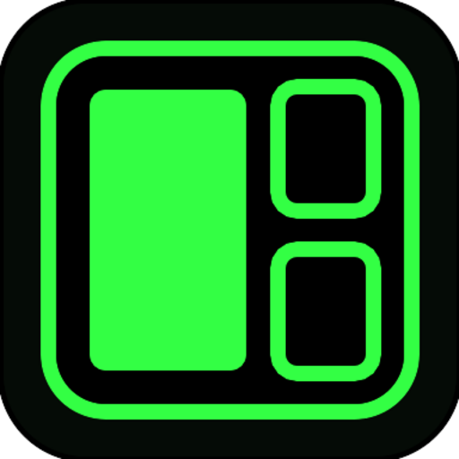
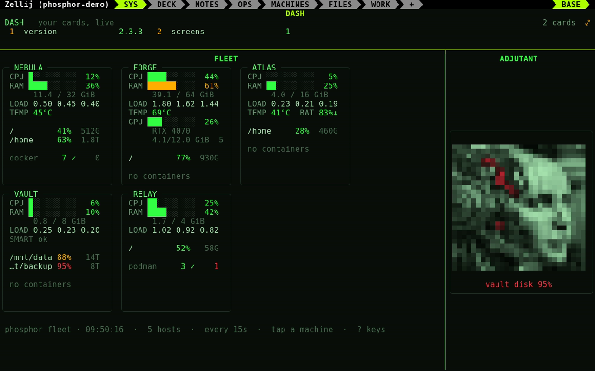
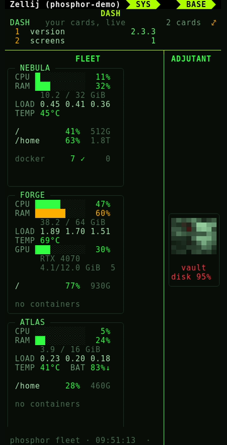
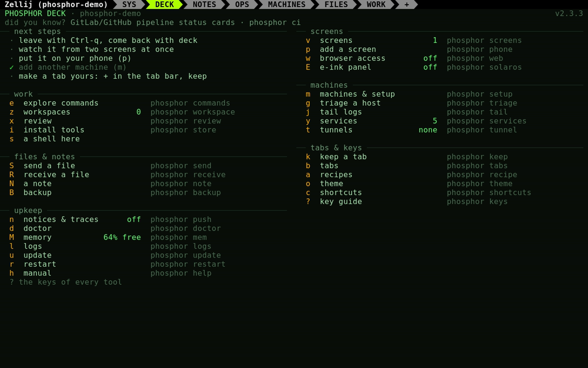

<p align="center"></p>
<p align="center"><a href="https://rsmedrano-cloud.github.io/phosphor-deck/">Manual, online</a></p>

# Phosphor Deck

One always-on brain, many faces.

Your working session stops living inside a device. It lives on a machine
that never sleeps, and anything with a terminal is a window into it. Pick up
the phone and you're where you left off: same tabs, same scrollback, the
half-typed message still in the box.

The only thing you carry is one command. No launcher, no apps to open and
close, no browser dashboards: a handful of tabs, arranged once, with the
tools you actually use. Everything is text, every tool a static binary.

```
              ╔═══════════════════════════════════╗
              ║   BRAIN — the persistent session  ║
              ║   COMMS · WORK · SYS · CLOUD ...  ║
              ╚═════════════════╤═════════════════╝
                                │  ssh (or mosh)
        ┌──────────┬────────────┼────────────┬──────────┐
     desktop     tablet       phone         Pi        e-ink
```

Every screenshot here is `phosphor demo`: a throwaway session over
made-up machines and a made-up notebook, so a screenshot never carries a
real IP, hostname or note.



The same tab bar on a phone-width screen: the fleet stacks into one
column, narrowing its cards to whatever room the adjutant leaves.



And the DECK tab: every action a key or a tap away, as cards that follow
the screen's width.



## Quick start

Try it first, without touching anything of yours: a throwaway session over
made-up machines and a made-up notebook.

```sh
curl -fsSL https://raw.githubusercontent.com/rsmedrano-cloud/phosphor-deck/main/install.sh | sh
# fetches zellij, yazi, btop... into ~/.local/bin, no root (or, from a copy of the repo: sh install.sh)
phosphor demo        # look around; Alt-x leaves
phosphor demo --tour # the same, with a guide that has you try each thing
phosphor demo --stop # kill it and clean up
```

Then the real one, on the machine that will stay on: `phosphor init && phosphor gen
&& phosphor up && deck` (or say yes to the installer's "set it up now?").

| you need | for |
|---|---|
| Linux with `systemd` | the watchdog and the mounts (without it `gen` still writes layouts) |
| `curl`, `tar`, `python3` 3.8+ | the installer and Phosphor itself (`tomli` if below 3.11) |
| `ssh` | only if you declare other machines |
| `fuse3` | only for the `~/fleet` mounts |

`phosphor doctor` checks all of it. Details under [Requirements](#requirements).

## What you get

- **One session, many screens.** A persistent zellij session with a
  watchdog, on a machine that stays on; a desktop, a tablet, a phone, an
  e-ink reader are windows into it ([screens](doc/manual/phones.md)).
  Coming back, one screen says what happened while you were away.
  A screen nobody has tried starts with `phosphor screen --probe`.
- **Tabs, not apps.** Laid out once from your profile; the `+` in the tab
  bar opens a shell here or on any machine, an assistant, files, any
  command, or several panes at once ([keys](doc/manual/keys.md)).
- **Your machines, watched.** One card per machine (CPU, RAM, disks,
  containers, failed units, updates, temperature) over plain ssh, nothing
  installed on them, and whether your services still answer; their files under `~/fleet`, nothing copied. An
  alert you already know about snoozes for a day, everywhere at once.
  The commands you keep typing on one get a name, and run from its card
  once you say `y`.
- **Cards of your own.** Every command as a card with its live value:
  pipelines, plan usage, who's attached; place them in any pane
  ([profile](doc/manual/profile.md)).
- **A notebook and workspaces.** Alt-j writes a note from any tab; a
  workspace is a tab per idea with its folder and its assistants
  ([workspaces](doc/manual/workspaces.md)).
- **Files between screens.** One clipboard for every screen; a real file as
  a one-time link and QR, or uploaded the same way
  ([clipboard](doc/manual/clipboard.md)).
- **Made to remember.** The DECK tab has every action a key away, `?` on
  any screen lists its keys, Esc and q mean the same everywhere.
- **For scripts and assistants.** `--json` on every listing, `phosphor
  mcp`, and [AGENTS.md](AGENTS.md) for an AI assistant working on the deck.

The whole tour, part by part: **[What you get](doc/manual/tour.md)**.

## Keys

zellij runs in **locked mode**: it intercepts nothing, every key goes to the
tool inside. Only these are the deck's:

```
Alt-1..9       go to a tab (or tap it)
Alt-← ↑ ↓ →    move between panes (or tap one)
Alt-z          zoom: the focused pane takes the whole tab (or tap ⤢ on a
               panel's title; Esc gives it back)
Alt-x, Ctrl-q  leave — the session keeps running
Alt-n          new tab in the folder of the pane you're in
Alt-r          edit this tab: unlock, change, save or put it back
Alt-j          a note or todo from here: NOTES shows which tab it came from
Alt-g          take zellij's controls, and give them back
Esc · q · ?    on the deck's own screens: Esc a step back (never closes a
               pane of the tab), q closes what you look at, ? its keys
```

They were picked so they don't collide with `matterhorn`, which uses a lot of
Ctrl and Alt keys, and every one can be changed: `phosphor shortcuts` (or `c`
in the DECK tab). Your keys live in the profile, so updates never reset them.
`?` in the DECK tab lists the keys of every installed tool.

## The manual

Everything, in depth, lives in [doc/manual](doc/manual/README.md) -- also
**[online](https://rsmedrano-cloud.github.io/phosphor-deck/)**, one page per
topic. `phosphor help TOPIC` shows it inside the deck; `phosphor help`
lists every command, and [the commands page](doc/manual/commands.md) says
what each one does. [AGENTS.md](AGENTS.md), built from the same pages, is
what AI assistants should read. [`share/commands.json`](share/commands.json)
is every command's one definition in JSON (usage, flags, which ones change
live state), for a script that wants to know without parsing prose. What
you can build on, and how anything there goes away:
[doc/manual/api.md](doc/manual/api.md). Contributing:
[CONTRIBUTING.md](CONTRIBUTING.md).

## Your data

Phosphor runs no listening daemon, installs no agents on the machines it
watches and sends no telemetry anywhere.

- **Fleet metrics** come from sending a `sh` script over SSH and reading its
  output. Nothing stays installed on the other side.
- **Files** travel over SFTP inside SSH. With tailscale that's also inside
  WireGuard: encrypted twice, never touching the open internet.
- **The session** lives on your machine. Nothing syncs to a cloud.
- **No root.** Everything is in `~/.local` and `~/.config`. A bug's blast
  radius is your user, not the system.

What Phosphor does **not** control, honestly:

- The tools you run inside do what they do. Your chat client (matterhorn,
  iamb, gomuks...) talks to its own server; an AI client talks to its API.
  Phosphor adds no leaks, but it doesn't stop the ones you bring in.
- Those clients keep credentials on disk in `0600` files. That's standard,
  not magic: anyone with your user can read them.
- Fleet mounts mean the brain holds an SSH key into your other machines.
  Narrow it in their `authorized_keys`, e.g. with `from="100.64.0.0/10"` if
  you use tailscale.
- What the fleet, a container's logs, a chat or a CI answer sends is shown
  as text: escape sequences in it are dropped before any screen sees them,
  so a compromised machine can't write your clipboard or repaint a pane.
  An ssh shell on that machine is a real terminal, and passes everything.
- Your profile is personal: host names, IPs, users. It lives in `~/.config`,
  not in the repo. If you fork and push, run `phosphor privacy` first.

## Tested on

| | |
|---|---|
| Debian 12 | end to end, as the brain and in a clean container |
| Ubuntu 24.04 | as a remote fleet host; as the brain, a clean install in a systemd container (every push) |
| Fedora | the same container install as the brain, every push; Fedora Atomic as a remote fleet host and a viewer |
| Android (Termux) | as a viewer, with touch |
| Raspberry Pi OS (Pi 4) | as a screen with a deck of its own: a 7" HDMI touch screen with no keyboard, and a 3.5" SPI LCD |
| Arch Linux | as the brain, real use, and the systemd-container install on every push |
| Alpine, NixOS, macOS, BSD | **never** |

Needs `systemd` for the watchdog and the mounts. Without it, `phosphor gen`
still writes the layouts but the units are useless.

## Requirements

`curl`, `tar`, `python3` 3.8+ (3.11+ has `tomllib` built in; older versions
need `tomli`), and `ssh` if you declare remote hosts. `fuse3` for the mounts.
`phosphor doctor` tells you what's missing and what it means.

If you run it on something that isn't listed above, say how it went — that's
the most useful thing the project can hear right now.

## Status

2.x, and public since 0.3.0. Day-to-day development happens on a private
GitLab (issues, merge requests, CI) -- [GitHub](https://github.com/rsmedrano-cloud/phosphor-deck)
is where releases land, starting from a single snapshot instead of that
private history. See CHANGELOG.md for the pace of actual releases, and
CONTRIBUTING.md for how a change gets from an idea to a tag. Bug reports
and feature requests are welcome there.

## Built on

Phosphor is glue, and glad to be: everything it actually shows you is one
of these, each a static binary `install.sh` fetches from its own upstream
release, invoked exactly as anyone else invokes it, never bundled or
modified. Full credit and thanks to their authors and every contributor.

| | |
|---|---|
| [zellij](https://github.com/zellij-org/zellij) | the terminal multiplexer the whole deck runs inside (installed in the version Phosphor is tested with, `share/versions.json`) |
| [yazi](https://github.com/sxyazi/yazi) | the file manager behind the CLOUD tab |
| [btop](https://github.com/aristocratos/btop) | the system monitor in every SYS/CLOUD tab |
| [gping](https://github.com/orf/gping) | the fleet's ping graphs |
| [ctop](https://github.com/bcicen/ctop) | container stats, where docker/podman is running |
| [rclone](https://github.com/rclone/rclone) | the sftp mounts behind `~/fleet` |

## License

MIT
